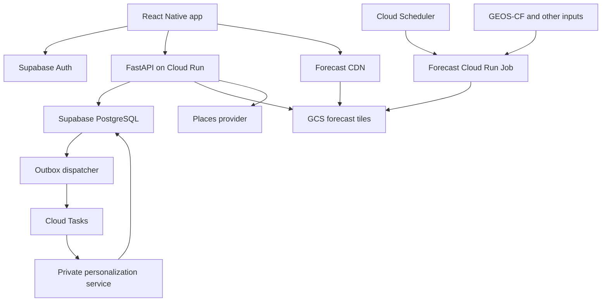

# AsthmaAware — Complete Project Context and Engineering Handoff

Prepared October 18, 2026. Captures the project decisions and discussion supplied through October 15, 2026.

## 1. How another GPT should use this document

This document is a self-contained handoff for continuing AsthmaAware product, backend, frontend, data, and ML planning. Read it before recommending a new architecture. Preserve the decisions already made unless the user asks to reconsider them or new evidence reveals a concrete problem.

**This is a design record, not an implementation audit.** Planned components must not be described as implemented, deployed, validated, or clinically effective without additional evidence. No repository was inspected for this handoff. There are no verified deployment URLs, performance results, user counts, or launch dates here.

Decision labels used throughout:

- **Confirmed:** The user explicitly selected or accepted the direction in the supplied conversation.
- **Current plan:** Part of the accumulated project design or project brief, but not necessarily individually approved as a final implementation contract.
- **Proposed:** An assistant recommendation or illustrative implementation detail that still needs agreement or validation.
- **Open:** Not decided, or insufficient evidence to determine the decision.
- **Deferred:** Intentionally excluded from the present design session.

The supplied conversation starts partway through an earlier discussion. This handoff combines that visible discussion with the current project brief and Nimbus data-request document. It does not reconstruct missing decisions as facts. An older “AsthmaAware Design Document” is referenced by the project copilot instructions, but its contents were not available in the sources read for this handoff. Do not claim it was reviewed.

Priority when sources conflict: latest explicit user decision, then current project brief, then earlier proposals, then generic copilot defaults. In particular, generic AWS defaults are superseded by the explicit GCP/GCS decision.

## 2. Project purpose and organizational context

AsthmaAware is a planned mobile application that helps people with asthma understand how environmental conditions may relate to their symptoms and make more informed choices about outdoor activities.

The initial geographic focus is **Atlanta**. The central idea is to combine shared environmental forecasts with an individual's symptom history, producing a shared starting prediction that can be adjusted for that individual over time.

The project is associated with **Georgia Tech's Big Data Big Impact (BDBI)** organization. BDBI has paired the team with **Akshata, a Microsoft employee**, as a mentor. Mentor discussions should focus on the project goal, intended experience, proposed architecture, validation priorities, and where guidance would help. Her Microsoft affiliation does not imply that the project uses Azure.

The project also has a prepared **Nimbus Health data request**. This is evidence of a data-acquisition plan, not proof of an established clinical partnership, an executed data-sharing agreement, or data receipt.

Product framing:

- Environmental and symptom-related decision support.
- Personalized estimates rather than guarantees of safety.
- A proposed display score, not automatically a calibrated probability of an asthma attack.
- Learned predictive adjustments, not proven causal sensitivities.

Do not invent clinical validation, diagnosis capabilities, treatment recommendations, measured benefit, completed infrastructure, or partnerships.

## 3. Core product experience

### 3.1 Dashboard

The dashboard is intended to show:

1. Current personalized predicted risk for a selected/current location.
2. An hourly intraday risk curve, discussed as approximately 24 hours.
3. Environmental contributors or explanatory information.

**Confirmed:** The backend performs dashboard personalization. The app receives computed results instead of fetching a complete map tile solely to personalize the dashboard.

Still open: exact curve duration and alignment, current-location permission behavior, manual location selection, risk labels and thresholds, and the explanation method.

### 3.2 Interactive risk map

The map allows users to **pan and zoom freely across Atlanta**. Forecast controls include **Now, +24 hours, +48 hours, and +72 hours**.

The map displays personalized values calculated on the device from shared numerical forecast tiles and the authenticated user's correction vector. The baseline population output is a numerical field, not a pre-colored heatmap image.

**Confirmed:** Load the selected forecast on demand, then selectively prefetch other forecast times for the visible region. Do not block initial interaction until all four forecast views are downloaded.

Map zoom changes visual scale, not environmental prediction resolution. Higher zoom must not imply finer predictions than the underlying 500 m grid.

### 3.3 Location detail view

Selecting a map location should provide personalized risk, environmental details, and explanatory information. The proposed view also includes environmental trends over the previous seven days.

**Current plan:** The backend computes location-detail personalization. Historical trends require retained historical environmental data; they cannot be reconstructed from the current future forecast alone.

Open: whether the seven-day window ends at the current time or selected forecast time, historical source type, aggregation, and treatment of future selections.

### 3.4 Activity recommendations

The app should help users compare nearby activity destinations such as parks, walking locations, and running destinations.

The proposed ranking considers predicted personalized risk, distance, and suitability for the requested activity. Google Places API is a proposed candidate discovery service; it is separate from map rendering and can be replaced by an equivalent provider.

Exact activity categories, search radius, ranking weights, route support, accessibility filters, and travel-distance semantics remain open. Do not infer continuous route exposure or turn-by-turn navigation from a destination-ranking feature.

### 3.5 Daily symptom log

**Confirmed:** One editable symptom entry per user per local calendar day. Editing replaces the active observation rather than adding another training sample.

Saving or editing a log should return without waiting for personalization training. An asynchronous worker updates the user's correction vector using the current history.

The symptom scale, label wording, exposure period, and rules for editing previous days have not been finalized. The supplied discussion approved editing the day's entry; it did not approve unrestricted historical editing.

## 4. Decision register

| Area | Decision / direction | Status | Reason or boundary |
| --- | --- | --- | --- |
| Initial region | Atlanta | Current plan | Initial product scope |
| App platform | React Native | Current plan | Mobile application |
| Forecast provider | NASA GEOS-CF | Confirmed | User identified the provider |
| Refresh cadence | Daily | Confirmed | Distinct from hourly output resolution |
| Forecast time resolution | Hourly | Confirmed | Each daily run contains hourly predictions |
| User forecast horizon | Now through +72h | Current plan | Main map experience |
| Output grid | 500 m Atlanta grid | Current plan | Target grid spacing, not validated accuracy |
| Environmental downscaling | Separate model/component | Confirmed, deferred | User explicitly postponed its design |
| Population prediction | Shared model g(x) | Current plan | Computed centrally |
| Personalization | Additive user correction w_u^T z | Current plan | Shared baseline plus individual adjustment |
| Map computation | Frontend personalization | Confirmed | Shared cacheable forecast data |
| Dashboard computation | Backend personalization | Confirmed | Simple point/time-series API |
| Map navigation | Free pan and zoom | Confirmed | Viewport-based delivery |
| Map library | MapLibre React Native | Proposed/current direction | User was open to libraries; technical fit needs prototyping |
| Map data contents | g(x) and standardized features together | Current plan | Both required to compute personalization |
| Spatial packaging | Geographic numerical tiles | Current plan | Avoid whole-region downloads |
| Time packaging | 24-hour chunks per geographic tile | Confirmed | Balance time-series reads and payload size |
| Loading strategy | On demand plus selective prefetch | Confirmed | Fast initial view with later cached views |
| Object storage | Google Cloud Storage | Confirmed | Replaces earlier S3 plan |
| Tile distribution | CDN | Current plan | Cache shared immutable data |
| Backend | FastAPI | Confirmed stack direction | Python application logic |
| Hosting | GCP; Cloud Run proposed | GCP confirmed | Specific managed services form current plan |
| Auth and database | Supabase Auth + PostgreSQL | Confirmed | User said this matched team thinking |
| Daily logs | One editable entry per local day | Confirmed | Avoid duplicate observations |
| Personalization updates | Asynchronous worker | Current plan | Keep logging responsive |
| Queue | Cloud Tasks | Proposed/current plan | Retried service-authenticated worker calls |
| Daily processing | Cloud Scheduler → Cloud Run Job | Proposed/current plan | Scheduled batch work |
| Reliable log-to-task handoff | Transactional outbox | Proposed | Avoid losing work between DB and queue |
| Redis | Not initially required | Proposed/current plan | Measure retrieval bottlenecks first |
| Population retraining | Separate from daily inference | Current plan | Not per symptom submission |
| Database schema | Next detailed design topic | Open | Entity inventory exists; DDL does not |

## 5. System architecture



Arrows show logical interactions, not a complete network or IAM design. CDN origin configuration, service identities, database connection mode, and deployment regions still require implementation design.

The outbox version makes the reliable path explicit: the API commits the symptom record and an outbox event together; a dispatcher later enqueues the task. An earlier simplified diagram showed API → Cloud Tasks directly. That direct arrow should not imply atomicity between PostgreSQL and Cloud Tasks.

### 5.1 Responsibility boundaries

| Component | Owns | Does not automatically provide |
| --- | --- | --- |
| React Native app | Screens, interaction, map tile selection, local map personalization | Population model training or downscaling |
| MapLibre | Map navigation and rendering integration | Automatic evaluation of the personalization formula |
| Supabase Auth | Registration, sign-in, reset, refresh, identity tokens | Application-specific model calculations |
| PostgreSQL | Private user records, logs, weights, operational metadata | Bulk forecast raster storage by default |
| FastAPI | Authenticated app APIs and backend personalization | Reimplementation of managed authentication |
| GCS | Versioned shared forecast objects and retained historical data | Automatic CDN delivery without serving configuration |
| CDN | Shared forecast distribution and caching | Caching private personalized API responses |
| Forecast job | Ingestion, feature preparation, inference, tile publication | Training a new population model every day by necessity |
| Personalization worker | User-specific refitting | Recomputing the shared population forecast cube |

### 5.2 Defaults that are not confirmed decisions

The copilot's generic defaults include TypeScript, Expo, React Navigation, Zustand, Jest, Pydantic, SQLAlchemy, scikit-learn, optional PyTorch/TensorFlow, and GitHub Actions. These are candidate implementation tools, not established repository facts. Select or verify them when implementation begins. The generic AWS ECS/RDS/S3 stack is superseded.

## 6. Environmental data and forecast semantics

### 6.1 GEOS-CF planning assumptions

The earlier assistant reported that NASA GEOS-CF provides daily forecasts with hourly outputs and approximately 120 hours/five days of coverage, on a coarse approximately 0.25-degree grid (roughly 25 km). It also mentioned an approximate publication time around 17:00 UTC.

These are **recorded source assumptions from the prior discussion**, not newly verified specifications in this handoff. Before implementing ingestion, verify the exact GEOS-CF version, collection, variables, units, valid timestamps, access route, and operational availability. Do not hardcode a publication-time assumption as a guarantee.

Reference URLs supplied in the earlier conversation:

- https://gmao.gsfc.nasa.gov/gmao-products/geos-cf/system-description_geos-cf/
- https://gmao.gsfc.nasa.gov/gmao-products/geos-cf/faq_geos-cf/

The user specifically asked that provider details come from NASA GEOS-CF documentation rather than repeated questions to the team.

### 6.2 Downscaling boundary

**Explicit user instruction: do not design the environmental downscaling model in this session.**

Treat it as a black box with this intended contract:

- Inputs: coarse environmental forecasts and any additional inputs the future downscaling design requires.
- Outputs: hourly environmental feature grids at the target 500 m Atlanta resolution, supporting at least the next 72 hours.
- Required metadata: spatial definition, valid times, feature schema, provenance, and pipeline version.

The overall storage plan anticipates about 120 hours when available. The precise downscaling output horizon must be aligned with that plan later. Do not assume the model design, training data, architecture, or accuracy has been established.

Interpolating a coarse grid does not establish accurate 500 m predictions. Keep target output spacing separate from effective predictive resolution.

### 6.3 Candidate environmental features

Features discussed include PM2.5, ozone, NO2, temperature, humidity, precipitation, wind, pollen, and NDVI/vegetation. The earlier NASA discussion also mentioned other pollutants such as CO, SO2, and PM10; this does not finalize them as model inputs.

The feature list is not frozen. Pollen and vegetation variables may require additional sources. Do not claim that GEOS-CF supplies every desired input. Units, temporal aggregation, missingness handling, spatial alignment, and feature transformations remain to be specified.

### 6.4 Issuance time versus valid time

Every forecast must distinguish:

| Field | Meaning |
| --- | --- |
| issued_at | When the upstream forecast was generated |
| valid_at | Actual hour represented by a prediction |
| forecast_run_id | Identifier of the processed dataset version |
| published_at | Proposed separate field for when our validated run became available |

A user opening the app at 2 PM should see the forecast for 2 PM, not the first hour of whichever run was fetched. Relative controls such as +24h must resolve to actual timestamps.

Approximately five days of source coverage provides room for a rolling +72h experience between daily updates. Delays can still exhaust coverage. Never silently substitute a different hour when a requested hour is missing.

Open details: rounding to hour boundaries, interpolation between hours, timezone presentation, stale thresholds, and how long a selected relative time remains anchored while the user browses.

## 7. Prediction and personalization model

### 7.1 Mathematical contract

Use consistent notation:

\[
\hat y_u(x) = g(x) + w_u^\top z
\]

\[
r_u = T(\hat y_u)
\]

where:

- x is the environmental input representation for the population model.
- g(x) is the shared generalized symptom prediction.
- z is the standardized feature vector used for personalization.
- w_u is the user's learned linear correction vector.
- y-hat is predicted symptom severity on the model's target scale.
- T is the as-yet-unfinalized transformation to a proposed 0–100 display risk score.

Earlier shorthand used w_u^T x. The later clarification uses z to make standardization explicit. Do not mix raw and standardized features.

The correction belongs on the prediction scale before display-score conversion. Do not add a severity correction directly to an arbitrary 0–100 score or modify image colors as a substitute for the numerical calculation.

### 7.2 Example, strictly illustrative

For one cell/hour, suppose g(x)=2.1, z=[0.6,-0.2,0.3], and w_u=[0.5,0.2,-0.1]. Then:

\[
\hat y_u = 2.1 + 0.5(0.6) + 0.2(-0.2) - 0.1(0.3) = 2.33.
\]

These are not measured values, chosen severity units, production weights, or clinical thresholds. T(2.33) cannot be assigned a production score until T is defined.

### 7.3 Population model

The population model supplies the generalized starting prediction. It is run centrally across the environmental grid and valid hours during forecast generation. Devices do not need to execute the population ML model.

Open: model family, target definition, training cohort, features, losses, validation, baseline comparisons, training data sufficiency, and promotion criteria. Do not infer a finalized ConvLSTM or another architecture from unrelated earlier project descriptions.

### 7.4 User refitting

The intended worker loads the user's latest symptom history and corresponding environmental exposures, then refits a regularized linear correction. A useful conceptual residual target is observed severity minus the population prediction under a compatible feature/exposure definition, but the exact loss and fitting procedure are not settled.

Open: regularization strength, intercept, minimum observations, warm start, history weighting, temporal features, bounds, cold-start behavior, and fallback when a fit fails. Zero correction is a plausible fallback, not a confirmed product rule.

The worker must use one active observation per daily log. Edits cannot become extra independent samples. Concurrent jobs must not allow a fit based on older history to overwrite one based on newer history.

### 7.5 Explanations and score interpretation

w_u is a predictive correction relative to the population model. Its weights alone do not explain the full prediction g(x)+w_u^T z. Top-contributor UI needs a defined attribution method for the full calculation or clearly labeled components.

A positive correction can mean a higher prediction than the baseline under a particular feature configuration; it does not prove a pollutant causes the user's symptoms. Standardized inputs can be negative. Avoid simplistic causal interpretations of individual coefficients.

Risk transformation, clipping, category thresholds, calibration, and uncertainty presentation remain open. A 0–100 score is not automatically a probability.

### 7.6 Cross-platform consistency

Dashboard, map, location details, and recommendations must agree when given the same cell, valid hour, forecast run, model versions, and personalization version.

Version or otherwise identify:

- Population model and feature pipeline.
- Feature names and ordering.
- Standardization parameters and transformations.
- User-vector version and training-data revision.
- Risk transformation.
- Grid and tile format.

Shared fixtures should exercise the mathematical contract in Python and TypeScript, including negative standardized values, missing data, bounds, and version mismatches. The exact tolerance and mismatch fallback remain to be chosen.

## 8. Forecast storage, tiles, and CDN

### 8.1 What a tile contains

A tile is a delivery unit containing several environmental grid cells. Each geographic tile/time chunk contains:

1. Population predictions g(x).
2. Standardized environmental features z needed for personalization.
3. References or metadata sufficient to identify cells, timestamps, and compatible versions.

Whether raw environmental values are also embedded or recovered from a separately stored representation is open. Location details may need raw-unit values even though personalization uses standardized features.

**Important:** a numerical forecast tile is not the same as a rendered raster image, a basemap tile, or a 500 m environmental cell.

### 8.2 Confirmed temporal chunking

Each geographic tile is chunked into **24 hourly time slices**. Under an illustrative 120-hour run:

| Chunk | Forecast indices |
| --- | --- |
| 00 | 0–23 |
| 01 | 24–47 |
| 02 | 48–71 |
| 03 | 72–95 |
| 04 | 96–119 |

These are forecast indices anchored to actual valid times. They are not automatically local calendar days.

Example object names, not provisioned resources:

```text
 gs://asthmaaware-forecasts/runs/{forecast_run_id}/manifest.json
 gs://asthmaaware-forecasts/runs/{forecast_run_id}/chunk-00/tile-001.bin
 gs://asthmaaware-forecasts/runs/{forecast_run_id}/chunk-01/tile-001.bin
 gs://asthmaaware-forecasts/runs/{forecast_run_id}/chunk-02/tile-001.bin
 gs://asthmaaware-forecasts/runs/{forecast_run_id}/chunk-03/tile-001.bin
 gs://asthmaaware-forecasts/runs/{forecast_run_id}/chunk-04/tile-001.bin
```

The .bin extension is illustrative. Encoding, compression, tile dimensions, projection, zoom strategy, and no-data masks are not decided.

### 8.3 Dashboard reuse of tiles

The backend can reuse the same geographic tiles as the map. It must not download the entire Atlanta forecast dataset for each dashboard request.

For a location and approximately 24-hour curve:

1. Resolve coordinates to a grid cell.
2. Resolve the cell to its tile.
3. Identify one or two 24-hour chunks covering the requested valid times.
4. Read those tile objects.
5. Extract the cell's time series.
6. Apply personalization and return results.

The user corrected an earlier unnecessary assumption that the backend would need a whole-region file. Preserve that correction. The remaining concern is read amplification and payload size, not an inherent requirement for whole-region reads.

### 8.4 Map loading and rendering

1. Fetch a forecast manifest and compatible private personalization parameters.
2. Determine visible geographic tiles and the chunk containing the selected timestamp.
3. Fetch shared numerical data from the CDN.
4. Select the requested hour.
5. Compute g(x)+w_u^T z per visible cell.
6. Apply the shared risk transform and color rules.
7. Render the personalized overlay through the map integration.
8. Prefetch other relevant chunks for the visible viewport after the initial view is ready.

Panning fetches newly visible tiles. Revisiting a tile should reuse compatible cached data. Zoom can reuse environmental predictions; generating duplicate forecasts for every map zoom is unnecessary.

The proposed rendering approach creates colored raster overlays locally. MapLibre integration and efficient local image/tile handling need a prototype. MapLibre does not automatically compute the model formula. Native integration requirements must be verified before committing to an implementation.

### 8.5 Tradeoffs and caching

Requesting one selected hour currently downloads its 24-hour chunk. This is accepted as the initial packaging tradeoff, subject to measurement. Tile size depends on cells per tile, feature count, numeric precision, and compression; no payload-size target has been measured.

Shared numerical tiles are identical for all users and suitable for CDN caching. User vectors and personalized responses must remain private. A cached personalized overlay needs its personalization version in the cache identity; a shared raw tile does not depend on the user.

### 8.6 Manifest and publication

The current manifest plan includes forecast identity, issue time, valid coverage, grid definition, available tiles/chunks, model version, feature schema/order, and normalization metadata or references. Risk-transform compatibility should also be explicit.

Proposed publication discipline:

1. Write a new immutable run under a unique identifier.
2. Validate required objects and metadata.
3. Publish the run manifest.
4. Atomically update the pointer identifying the current complete run.
5. Keep the previous usable run available according to retention policy.

A calendar date alone may be insufficient to identify reruns or model revisions; a collision-resistant run identifier is an implementation recommendation. Clients should pin a run while loading related tiles to avoid mixing versions during a refresh.

Cloud CDN requires an actual origin/serving configuration, such as the appropriate load-balancer/backend-bucket setup. A GCS bucket alone is not a complete CDN design. Exact access policy is open.

## 9. Backend API inventory

The prior discussion proposed **15 FastAPI endpoints**: 13 authenticated app endpoints, one internal worker endpoint, and one operational health endpoint. Supabase-managed authentication and static CDN tile URLs are additional surfaces, not custom FastAPI endpoints.

This is a **proposed V1 inventory**, not an implemented OpenAPI specification. Exact field types, pagination, status codes, error schemas, limits, and compatibility behavior remain to be finalized.

| Method | Route | Access | Purpose |
| --- | --- | --- | --- |
| GET | /v1/users/me | User | Profile, activities, preferences |
| PATCH | /v1/users/me | User | Update profile/preferences |
| DELETE | /v1/users/me | User | Account deletion request |
| GET | /v1/dashboard | User | Current risk, contributors, hourly curve |
| GET | /v1/forecasts/manifest | User in proposed inventory | Current forecast metadata |
| GET | /v1/users/me/personalization | User | Compatible personal model parameters |
| GET | /v1/locations/analysis | User | Selected location/hour and historical detail |
| GET | /v1/activities/recommendations | User | Nearby ranked destinations |
| GET | /v1/symptoms/today | User | Today's log, if present |
| PUT | /v1/symptoms/today | User | Create or replace today's log |
| GET | /v1/symptoms | User | Symptom history |
| POST | /v1/devices | User | Register/refresh push token |
| DELETE | /v1/devices/{device_id} | User | Unregister owned device |
| POST | /internal/jobs/refit-personalization | Trusted service only | User-model refit |
| GET | /health | Operational | Service health |

### 9.1 GET /v1/users/me

Returns the authenticated user's profile. Discussed fields include id, name, selected activities, timezone, notification preference, and personalization status.

Read the user's identity from a verified token. Do not trust a request-supplied user_id to determine whose profile is returned. Profile creation on signup, absent-profile recovery, and exact personalization status states remain open.

### 9.2 PATCH /v1/users/me

Updates supported fields such as name, activities, timezone, and notification preferences. Validate supported activities and timezone identifiers. Identity and protected model fields should not be arbitrarily writable through a generic patch.

Open: notification schedule representation, partial-update semantics, and how timezone changes affect daily log assignment.

### 9.3 DELETE /v1/users/me

Requests account deletion and removal of user-owned data. This must coordinate application records with the Supabase Auth account and pending jobs.

Open: synchronous versus asynchronous completion, reauthentication, retention constraints, audit requirements, historical training-artifact implications, and how deletion completion is reported. Do not invent a complete deletion guarantee from the endpoint name alone.

### 9.4 GET /v1/dashboard?lat=...&lon=...

Returns a grid-cell identifier, forecast-run identity, current predicted risk/category, contributors, and an hourly risk series. The illustrative earlier value of 63 with a “moderate” label was not a finalized threshold.

Execution: validate coordinates and coverage; resolve the cell/tile/chunks; retrieve the shared forecast data; load compatible user weights; compute predictions; apply the risk transform; calculate the selected explanation; return the series and provenance.

Open: forecast-run pinning parameters, requested time interval, response for out-of-region points, unavailable hours, stale forecasts, and version mismatches.

### 9.5 GET /v1/forecasts/manifest

Returns the current usable forecast manifest or a reference to it. It tells the app how to locate numerical tile objects and which valid hours exist.

Discussed fields include forecast_run_id, issued_at, valid_from, valid_to, chunk_hours=24, grid_resolution_m=500, feature_schema_version, and tile_url_template. Full schema also needs enough spatial information to select a tile, model/normalization compatibility, and exact timestamp semantics.

The proposed endpoint inventory marks it authenticated even though the underlying forecast data is shared. Whether manifest access needs authentication is still an access-policy decision; do not assume authentication makes shared tile data user-specific.

### 9.6 GET /v1/users/me/personalization

Returns the current user's learned correction vector and compatibility metadata. Discussed fields include weights, feature_names, population-model version, feature-schema version, and risk-transform version.

Recommended additions to consider: personalization revision, normalization identifier, training-data revision, updated_at, and fit status. These are not finalized fields.

Do not publicly cache this response. The app needs the vector for local map computation; being available on the user's device is intentional, not a reason to publish it through the shared forecast CDN.

### 9.7 GET /v1/locations/analysis?lat=...&lon=...&time=...

Returns selected-location risk, environmental details, top contributors, and the proposed historical environmental trend view. Resolve the explicit timestamp and validate forecast coverage. Use retained historical data for the previous-week component.

Return sufficient provenance to explain differences from the map if run or personalization versions changed. Exact raw-unit variables, history anchor, and response structure remain open.

### 9.8 GET /v1/activities/recommendations?lat=...&lon=...&activity=...&time=...

Proposed execution:

1. Get candidate places from the chosen places provider.
2. Resolve candidates to grid cells.
3. Retrieve relevant forecasts, reusing tiles across candidates where possible.
4. Apply the user's compatible personalization.
5. Apply activity suitability filters.
6. Rank using risk and distance.
7. Return candidates with place identity, coordinates, score, distance, and suitability information.

Open: candidate limit, radius, distance computation, pagination, ranking weights, provider restrictions, empty-result behavior, and forecast coverage at candidate locations. No travel-time or route integration has been approved.

### 9.9 GET /v1/symptoms/today

Determines the user's current local date and returns that day's active log if present. The absent-entry response convention is open. The server's UTC date must not silently substitute for the user's local calendar date.

### 9.10 PUT /v1/symptoms/today

The earlier illustrative body contained severity, latitude, and longitude. This is not a frozen schema or severity range.

Proposed execution:

1. Authenticate the caller.
2. Validate symptom input and location.
3. Resolve the local log date.
4. Associate the relevant environmental exposure vector/window.
5. Upsert the record under a unique (user_id, log_date) constraint.
6. Store exposure provenance and an outbox event in the same transaction.
7. Return the saved entry without awaiting training.

Daily-average exposure and the preceding 24 hours were suggestions, not a final alignment rule. The symptom question must match the exposure period. Do not treat a single submitted location as proven all-day exposure or assume future hours represent completed exposure.

If exposure data is unavailable, whether to save a pending log or reject the request is open. Offline retries crossing midnight also need a defined contract; a mutable “today” route alone does not solve that case.

### 9.11 GET /v1/symptoms?start=...&end=...

Returns the authenticated user's historical logs in a requested date interval. Exact ordering, pagination, maximum range, and whether exposure details are included remain open.

### 9.12 POST /v1/devices

Registers or refreshes an authenticated user's push token. The proposed design needs a device identifier, provider token, and suitable platform metadata, but the schema is open. Token refresh, account switching, ownership reassignment, and invalid-token cleanup must be handled deliberately.

### 9.13 DELETE /v1/devices/{device_id}

Unregisters a device owned by the authenticated user. Decide idempotent behavior for already-removed registrations. Avoid using another user's device identifier to modify their registration.

### 9.14 POST /internal/jobs/refit-personalization

Called by Cloud Tasks using trusted service identity, not ordinary user authentication. The earlier example payload contained user_id and trigger_log_id. A data revision or equivalent concurrency guard is a proposed addition.

The worker loads current history, verifies model compatibility, refits, and commits only if its result is not stale. It should be safe to retry and should handle users deleted after a task was queued.

This may live on a separate private Cloud Run service even though it appears in the combined logical route inventory. Exact completion, retryable error, and permanent-failure handling remain open.

### 9.15 GET /health

Operational health endpoint. Liveness versus readiness, dependency checks, deployment probes, and externally visible detail remain open. Do not return secrets or sensitive records as health diagnostics.

## 10. Background jobs and scheduling

A background job does not inherently need a FastAPI endpoint. Cloud Scheduler can invoke the managed API to launch a Cloud Run Job. Cloud Tasks commonly invokes an authenticated HTTP handler, which is why the personalization worker has a private endpoint.

| Workload | Proposed trigger | Execution | Custom HTTP endpoint? |
| --- | --- | --- | --- |
| Daily forecast pipeline | Cloud Scheduler after source availability | Cloud Run Job | No app endpoint required |
| User refit | Outbox → Cloud Tasks | Private Cloud Run service | Yes |
| Population training | Initially manual; later periodic | Training job | Not inherently |
| Symptom reminders | Timezone-aware schedule | Cloud Run Job | Not inherently |
| Outbox dispatch | Frequent schedule or managed process | Dispatcher | Depends on chosen implementation |
| Freshness/monitoring | Periodic and per-run | Jobs/monitoring | Not inherently |
| Retention cleanup | Schedule | Job/storage lifecycle | Not inherently |

### 10.1 Daily forecast pipeline

Planned sequence:

1. Identify and obtain the upstream run.
2. Validate input availability and metadata.
3. Execute the deferred environmental preparation/downscaling component.
4. Align features to the target grid and hourly timestamps.
5. Apply the versioned feature transformations required by the models.
6. Run population inference g(x).
7. Package g(x) and personalization features into geographic 24-hour chunks.
8. Upload versioned objects to GCS.
9. Validate output completeness and values.
10. Publish the completed manifest/current-run reference.
11. Record status and diagnostics.

A forecast_runs table was proposed for source timestamps, versions, status, and errors. Run retries should not expose partial data or overwrite unrelated versions. Keep the last usable forecast available when a new run fails. An older run is usable only for hours it actually covers.

Cloud Run Jobs are the proposed starting point. If eventual downscaling workloads require different resources or runtime characteristics, revise that component after measuring requirements; do not choose its compute architecture prematurely.

### 10.2 Outbox dispatcher

The proposed transactional outbox closes the gap between saving a symptom entry and creating a queue task. Store both the symptom change and the event in one database transaction. Dispatch committed events later; retries and duplicate delivery are expected design cases.

Open: dispatcher hosting, polling frequency, locking/claiming, event identifiers, retry policy, terminal failures, and task deduplication. No extra public endpoint is required by the concept itself.

### 10.3 Personalization worker

Read current active observations, construct compatible training inputs, fit the user's correction, and save a versioned result. Use per-user serialization or revision checks so older work cannot overwrite a newer fit. Exact concurrency implementation is open.

Updating a vector does not require regenerating shared forecast tiles. The app must learn that new weights are available and invalidate any personalized render cache; polling, refetch-on-focus, or another refresh mechanism has not been chosen.

### 10.4 Population retraining and promotion

Keep training distinct from daily inference and per-user refitting. Proposed flow: build an eligible dataset, train a candidate, evaluate against production, store artifacts and metrics, validate before promotion, then regenerate compatible forecasts and refit/migrate personal corrections as needed.

Promotion changes the baseline against which corrections were learned. Do not pair old residual corrections with a new population model without a defined compatibility/migration policy.

Training frequency, approval process, registry, metrics, eligible-data rules, and rollback mechanics remain open. No deployed model registry is established.

### 10.5 Reminders

Proposed scheduled reminders target users who have not logged symptoms and have enabled notifications. The job needs timezone, reminder preferences, and device registrations. Firebase Cloud Messaging was offered as an example provider, not a final selection.

Deduplicate by user/local day/reminder type or an equivalent key. Frequency and scheduling granularity are open; one global daily invocation is not automatically sufficient for all local reminder times. Keep sensitive health details out of notification content by design.

### 10.6 Monitoring and retention

Proposed checks include forecast freshness, missing features, invalid ranges, unexpected distributions, prediction drift, failures, API latency, and historical-data retention. Secret Manager and Cloud Logging/Monitoring are proposed GCP services.

Thresholds, alert recipients, budgets, data retention periods, and service-level targets have not been selected. Forecast freshness and model quality are different concerns and should not be conflated.

## 11. Database design: agreed needs, unfinished schema

The next natural design task is the PostgreSQL schema. The following are logical entities, not approved table names or final DDL.

| Entity | Information needed | Important relationship or invariant |
| --- | --- | --- |
| Profiles | Auth identity, name, timezone, preferences | Linked to Supabase Auth user |
| Activity selections | User's chosen activity types | Owned by user; taxonomy open |
| Symptom logs | User, local date, severity, location association, timestamps/revision | One active log per user/date |
| Exposure snapshots | Feature values, window, location/cell, provenance, pipeline version | Traceable inputs for a symptom observation |
| Personalization parameters | Weights, feature/model versions, fit status/revision | Must match served forecasts |
| Devices | User association, token, platform, lifecycle state | Private ownership and refresh handling |
| Forecast runs | Source issue time, coverage, versions, status, manifest reference | Tracks shared forecast publication |
| Outbox events | Event identity, user/log/revision, dispatch state, attempts | Saved atomically with log mutation |
| Model metadata | Population/normalization/transform artifact references | Proposed support for reproducibility |
| Notification delivery records | Reminder identity and result | Proposed retry deduplication support |

Arrays versus relational activity tables, weight-vector storage format, exposure snapshot normalization, indexes, foreign-key deletion behavior, and migrations remain open.

RLS was recommended for user-owned tables as defense in depth. FastAPI must also enforce authorization. A server using a privileged database role does not automatically gain user-scoped RLS merely because it validated a JWT; the chosen DB access mode and role need explicit design.

## 12. Historical exposure and data acquisition

### 12.1 Environmental history

Two use cases require history: the location detail view's previous-week trends and matching symptom observations to past environmental conditions.

Retained forecasts, observed measurements, and analysis products are different data types. Record provenance and do not label an archived prediction as an observation. The exact historical source and retention policy are open.

Training reproducibility requires enough information to recover which features were associated with each symptom record. Saving exposure values or immutable references plus pipeline version was proposed. Do not silently replace historical inputs with the newest pipeline's recomputation without a version policy.

### 12.2 Nimbus Health request

The current request seeks asthma records from the most recent 3–5 years, or the longest available period. Atlanta and Georgia are the initial focus, but other regions may be useful. It asks for routine/stable periods alongside flare-ups.

Cross-record priorities:

- Consistent anonymous study patient identifiers linking records.
- Timing of symptoms separately from documentation time.
- Patient residence or location during symptoms, distinguished from clinic location.
- Definitions, units, codes, and dataset limitations.

Requested categories:

1. **Visits:** time/type/location; reasons and diagnoses; symptoms, severity and onset; available oxygen saturation, respiratory rate, lung function/peak flow and relevant tests; treatment, response, disposition and follow-up.
2. **Medication:** prescriptions, doses, frequency, start/end dates and changes; rescue/controller medicines, steroids, biologics, allergy medicines; refill and actual-use information where available, distinguishing prescriptions from confirmed use.
3. **Nurse calls and patient reports:** de-identified notes/transcripts; time, symptoms, onset, triggers, prior medication, advice, urgency, referrals and outcome; repeated reports, questionnaires, nighttime symptoms, activity limitations, home measurements, and reports of no symptoms.
4. **Background:** available demographics, asthma history/severity, prior flare-ups, allergies/triggers, comorbidities and family history; smoking/vaping/secondhand smoke and home/work exposures; already-recorded broad socioeconomic and housing information where available.

The highest priorities are repeated linked observations plus enough timing, location, and medication context to align symptoms with environmental conditions. **A day without a visit or call must not be assumed symptom-free.**

Existing spreadsheet/database exports are acceptable, with a column guide and information about years, approximate cohort size, gaps, and restrictions. The request does not ask Nimbus to collect new information or supply every category.

Names, contact details, medical record numbers, and street addresses are not requested. Detailed time/location handling requires an agreed arrangement. If those cannot be shared, environmental matching inside Nimbus and sharing the resulting exposure values is an alternative proposed in the request.

The requested next step is an availability/restrictions assessment and a small approved sample plus column guide. Data receipt, usable sample size, training permission, and label compatibility are not established by this request.

## 13. Privacy, authorization, and reliability requirements

Current design guidance:

- Verify Supabase tokens on protected APIs and derive user identity from the verified token.
- Authorize all user-owned reads and writes.
- Keep symptom logs, device tokens, profiles, and correction vectors out of public forecast caches.
- Authenticate Cloud Tasks-to-worker traffic using service identity and restrict worker access.
- Store credentials in a secret-management mechanism; do not embed them in clients.
- Use explicit version/provenance contracts across forecasts, training, and inference.
- Make retries safe for log writes, queue delivery, refits, publication, and reminders.
- Return a useful failure or unavailable state instead of inventing forecasts or silently mixing versions.

These are design requirements, not proof of implemented security controls or compliance certification. Exact consent flows, retention rules, data-use permissions, and deployment security review remain to be completed.

## 14. Corrections and superseded directions

1. **AWS S3 → GCS.** S3 was discussed first; the user approved GCS after choosing GCP. Use GCS in the current architecture.
2. **Backend-personalized map → frontend personalization.** The user selected on-device map adjustment. Backend personalization remains for the dashboard and location analysis.
3. **Baseline heatmap alone → baseline plus features.** g(x) alone cannot support w_u^T z. Shared tiles contain both.
4. **Image modification → numerical computation then rendering.** Do not treat personalization as recoloring an existing generalized heatmap without its numerical inputs.
5. **Whole Atlanta file per dashboard → relevant tile/chunks.** The user correctly noted that existing tiling already avoids whole-region reads.
6. **All hours in a tile or one file per hour → 24-hour chunks.** The user chose the middle ground explicitly.
7. **Load all four times first → selected time plus selective prefetch.** The user accepted the latter.
8. **500 m native NASA data → separate planned downscaling.** NASA's source resolution and target output grid are different.
9. **Design downscaling now → defer it.** Do not reopen that design unless asked.
10. **Generic AWS defaults or Microsoft-implies-Azure → GCP.** Organizational relationships do not override deployment choices.
11. **Correction coefficients as full explanations → explanation method unresolved.** Population effects still matter.
12. **Latest forecast as all history → explicit historical retention/retrieval.** Past environmental information needs its own provenance and coverage.

## 15. Open questions and implementation risks

| Topic | Unresolved decision / evidence needed | Why it matters |
| --- | --- | --- |
| Symptom target | Scale, question wording, temporal meaning | Defines the supervised learning task |
| Exposure alignment | Calendar day vs trailing window, location representation | Prevents mismatched labels and features |
| Training data | Availability, eligibility, repeated observations, permissions | Determines feasible model development |
| Hourly prediction validity | How daily symptom labels support hourly outputs | Daily training labels do not automatically validate hourly severity |
| Population model | Family, features, loss, validation | g(x) is an interface, not a chosen algorithm |
| Personalization | Regularization, intercept, history length, cold start | Controls stability with sparse data |
| Score | Transform, calibration, bounds, categories | Defines what users actually see |
| Explanation | Attribution of baseline plus correction | Avoids misleading contributor labels |
| Downscaling | Intentionally deferred | Needed eventually; not part of this session |
| Feature sources | Source/units for each feature | GEOS-CF does not cover all candidates by assumption |
| Tile layout | Spatial extent, encoding, compression, projection | Determines mobile payload and parsing cost |
| Rendering | Local raster integration and performance | Must prove feasibility in React Native |
| Forecast compatibility | Client pinning, refit migration, fallback | Prevents mixed-model predictions |
| Historical data | Source, time window, retention, observation vs estimate | Needed for details and symptom matching |
| Time semantics | DST, travel, timezone edits, offline retry | Protects one-log-per-day behavior |
| Places | Provider, ranking, radius, distance semantics | Determines recommendation behavior and cost |
| Infrastructure | Regions, IAM, CDN origin, DB connectivity, quotas | Needed before deployment |
| Operations | Retry policies, monitoring, stale thresholds | Required for graceful failures |
| Scale/budget | Launch users, latency targets, cost limit | Not answered in the visible conversation |
| Product scope | Reminders, deletion, detailed history priority | Endpoint proposal may exceed first vertical slice |
| Schema | Tables, constraints, indexes, migration plan | Next detailed design step |

These are remaining questions, not reasons to discard the agreed architecture or claim all decisions must restart.

## 16. Suggested next work sequence

This sequence organizes unfinished work; it is not a new user-approved roadmap or schedule.

1. **Design the PostgreSQL schema** supporting profiles, editable daily logs, exposure provenance, compatible weights, device records, forecast metadata, and outbox dispatch.
2. **Specify the shared model contract:** feature order, normalization, population version, user-vector revision, risk transform, and mismatch behavior.
3. **Define the symptom/exposure semantics** before using daily logs as training examples.
4. **Turn the endpoint inventory into concrete schemas:** request/response models, access checks, errors, time conventions, and pagination.
5. **Prototype one end-to-end slice:** a known cell/hour, numerical tile, backend dashboard response, and locally personalized map value with matching results.
6. **Measure mobile tile/rendering behavior** before optimizing or changing the agreed chunking.
7. **Implement reliable asynchronous logging/refitting** with revision protection and a durable enqueue mechanism.
8. **Implement complete forecast publication and stale-data behavior.**
9. **Develop/evaluate models** when suitable data is available; handle downscaling in the later session the user requested.

High-value acceptance checks for future work:

- Same inputs and versions yield matching backend/frontend results.
- Editing a daily log does not increase the number of active training observations.
- A retried or out-of-order task cannot corrupt newer weights.
- A partial forecast run never becomes the current complete run.
- An expired or missing requested hour is shown as unavailable rather than replaced silently.
- A dashboard reads relevant tile chunks, not the full region.
- Panning and revisiting data reuse compatible cached tiles.
- Authentication prevents cross-user profile, log, vector, and device access.
- Historical trends identify their actual source and provenance.

## 17. Mentor presentation context

A separate project brief requested approximately nine slides for a 10–12 minute first meeting with Akshata. It emphasizes short visible wording, conceptual app visuals, detailed speaker notes, and a clear distinction between planned and completed work.

The intended story covers the problem, user experience, environmental pipeline, personalization, system architecture, daily feedback loop, validation priorities, and mentorship questions. Useful discussion prompts include what to simplify or validate first and where the largest architecture or ML risks lie.

Presentation requirements are communication requirements, not product specifications. For example, a nine-slide structure does not restrict this engineering handoff, and illustrative app values are not model results.

## 18. Source record and limitations

This handoff was assembled from:

1. The user-supplied architecture conversation, including explicit decisions about GEOS-CF, deferred downscaling, frontend map personalization, free map navigation, selective prefetch, backend dashboard personalization, 24-hour chunks, Supabase, editable daily logs, GCP, GCS, and the subsequent endpoint/job proposal.
2. The current contents read from **Pasted text.txt**, the AsthmaAware mentor-presentation brief, and its duplicate timestamped copy. These supplied a consolidated project description and carefully marked planned capabilities.
3. The current contents of **AsthmaAware_Nimbus_Data_Request.docx**, version 1, for the data-acquisition context.
4. AsthmaAware copilot instructions, used for project orientation and to identify generic defaults that must not override explicit decisions.

The older named design document was not retrieved. The original pre-excerpt model discussion is not fully visible. No repository, production system, external NASA documentation, clinical dataset, or runtime configuration was audited during this handoff. External provider details are preserved as planning assumptions to verify during implementation, not presented as fresh research.

## 19. Compact continuation prompt for another GPT

> You are helping continue AsthmaAware, an Atlanta-focused React Native application for environmental and symptom-related decision support. Read this entire handoff before proposing changes. Preserve explicit decisions: daily GEOS-CF updates with hourly forecasts; a planned 500 m grid; environmental downscaling deferred to a later session; shared population prediction plus user linear correction, y_hat = g(x) + w_u^T z; frontend map personalization; backend dashboard and location personalization; free pan/zoom; numerical geographic tiles containing g(x) and personalization features; 24-hour time chunks; on-demand loading plus selective prefetch; GCP/GCS; Supabase Auth/PostgreSQL; FastAPI; and one editable symptom log per local day with asynchronous refitting. Treat MapLibre, Cloud Run/Scheduler/Tasks, transactional outbox, exact endpoints, and other implementation details according to the decision statuses in this document. Distinguish confirmed decisions from proposals and unknowns. Do not invent implementation progress or clinical validation. Do not redesign downscaling unless asked. The last suggested next topic was a detailed PostgreSQL schema supporting the endpoint and job inventory.
