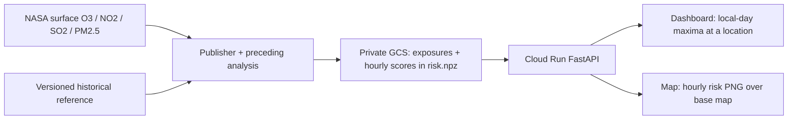

# NASA population-risk map

The map uses the dashboard's exposure artifact, general-risk function and fixed
reference distribution. It is public and does not use symptom reports or
individual personalization. Scores are relative 0–100 ranks against the
configured reference, not a probability of an asthma attack.



## Processing and storage

The publisher prepares lagged exposures and saves hourly population scores as
`general_scores` in the existing compressed `risk.npz`. Scores remain on the
compact source grid, with explicit mappings to the 420 × 408 serving grid.
Today's 0.25° NASA values are inherited on the required 0.01° grid; this does
not create new spatial detail. Old NPZs work by calculating scores once on load.

GCS publication stays atomic: risk uploads finish before `published/current.json`
advances. No new bucket, table, public storage access or map secret is needed.
PNG responses are derived on demand, cached in memory (24 frames per process),
and not separately persisted in GCS. A cold Cloud Run instance reconstructs
them from the durable NPZ.

Actual bounds: west −85.60°, south 30.78°, east −81.52°, north 34.98°. This is
the existing model footprint, not the full Georgia boundary. Savannah and
areas outside the rectangle have no layer. Expanding coverage requires a
coordinated change to the artifact grid and any ML model footprint.

## API and availability

- `GET /v1/map/forecast`: source run, SHA-256 `run_id`, issue time, stale and
  provisional flags, bounds, fixed colors, and valid hourly frame indices.
- `GET /v1/map/frame?run_id=<sha256>&index=<frame-index>`: PNG data URI, valid
  time and availability. Missing cells are transparent.

Both are public, use normal API CORS, and never read the database. Responses
use `Cache-Control: no-store` to recheck time availability and run identity.
The app explicitly caches 12 images by immutable run/index. A run mismatch
returns 409 and triggers a metadata refresh. An out-of-window hour returns 404;
missing or expired publications return 503. There is no synthetic fallback.

Available frames follow the dashboard: the current hourly interval and future
midpoints up to 96 hours ahead, limited by the run's actual end. Runs older
than 24 hours retain their remaining hours with a stale label. All-missing
hours remain explicit and display no layer.

## Frontend

The existing map, Heat/Grid toggle, zoom controls and timeline remain; the
dummy Georgia generator is removed. Each timeline step selects a real hourly
frame, labeled in America/New_York. Returning to the tab or waiting five minutes
revalidates metadata. Scrubbing is debounced and obsolete requests are aborted.
An old image is never shown under a different hour's label. Failures clear the
layer and offer retry.

MapLibre draws a georeferenced image. Latitude is warped to Mercator image
coordinates with fourfold vertical oversampling to retain source rows. Grid
uses nearest-pixel sampling; Heat linearly interpolates the same image colors.
Heat is visual smoothing, not a separate risk calculation or density estimate.
Both modes use a fixed 0–100 palette without per-hour/viewport normalization.
The UI notes provisional calibration, older runs and limited coverage.

The same HTML runs in a sandboxed iframe on web and a WebView on mobile.
The app retrieves images through FastAPI and passes them through the bridge;
the renderer needs no GCS URL or credentials. Base tiles and map assets still
require OpenFreeMap and unpkg access.

## Local and cloud operation

Existing local risk NPZs work immediately. For a new publication, run from backend:

```powershell
python -m scripts.publish_dashboard_forecast --reference data/risk/reference-development.npz
python -m uvicorn app.main:app --reload --port 8000
```

Follow [the deployment guide](deploy-forecast-gcs.md) for Cloud Run/GCS. The job
needs `RISK_REFERENCE_OBJECT` plus `FORECAST_GCS_BUCKET`; the API needs only
`FORECAST_GCS_BUCKET` for map storage. Keep references immutable and versioned.
Use attached service accounts through Application Default Credentials. Set
`EXPO_PUBLIC_API_URL` to the HTTPS API, configure the frontend origin in CORS,
and rebuild/restart the frontend. No map migration is required. Schedule the
publisher regularly and alert on job failures/stale forecasts. Live GCP rollout
remains an infrastructure step; local tests mock GCS rather than deploy resources.

Verification covers hourly general scores versus dashboard daily maxima,
missing-cell transparency, fixed colors, spatial alignment, run transitions,
expiry and cold-cache cloud reads. A personalized dashboard can differ because
it blends individual symptom-based adjustments; the map stays population risk.
