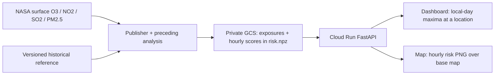

# NASA population-risk map

The map uses the dashboard's exposure artifact, general-risk function and fixed
reference distribution. It is public and does not use symptom reports or
individual personalization. Scores are relative 0–100 ranks against the
configured reference, not a probability of an asthma attack.



## Processing and storage

The publisher prepares lagged exposures and saves hourly population scores as
`general_scores` in the existing compressed `risk.npz`. Activated fine artifacts
hold individual exposures and scores on the 420 × 408 grid. O3 uses learned
surface downscaling; surface NO2, SO2, and PM2.5 currently inherit native cell
values. These inherited inputs can still cause visible 0.25° boundary jumps.
Legacy compact source-grid artifacts remain readable.

GCS publication stays atomic: risk uploads finish before `published/current.json`
advances. No new bucket, table, public storage access or map secret is needed.
PNG responses are derived on demand, cached in memory (24 frames per process),
and not separately persisted in GCS. A cold Cloud Run instance reconstructs
them from the durable NPZ.

Actual bounds: west −85.60°, south 30.78°, east −81.52°, north 34.98°. This is
the existing model footprint, not the full Georgia boundary. Savannah and
areas outside the rectangle have no layer. Expanding coverage requires a
coordinated change to the artifact grid and any ML model footprint.

## API and availability

- `GET /v1/map/forecast`: source run, SHA-256 `run_id`, issue time, stale and
  provisional flags, bounds, fixed colors, and valid hourly frame indices.
- `GET /v1/map/frame?run_id=<sha256>&index=<frame-index>`: PNG data URI, valid
  time and availability. Missing cells are transparent.

Both are public, use normal API CORS, and never read the database. Responses
use `Cache-Control: no-store` to recheck time availability and run identity.
The app caches up to 48 images, capped at 16 MiB of estimated string storage,
by immutable run/index. A run mismatch
returns 409 and triggers a metadata refresh. An out-of-window hour returns 404;
missing or expired publications return 503. There is no synthetic fallback.

Available frames follow the dashboard: the current hourly interval and future
midpoints up to 96 hours ahead, limited by the run's actual end. Runs older
than 24 hours retain their remaining hours with a stale label. All-missing
hours remain explicit and display no layer.

## Frontend

The existing map, Heat/Cells toggle, zoom controls and timeline remain; the
dummy Georgia generator is removed. Each timeline step selects a real hourly
frame, labeled in America/New_York. Returning to the tab or waiting five minutes
revalidates metadata, preserving the selected valid time when possible.
Cached hours display immediately; uncached selections are coalesced for 50 ms
to avoid fetching every intermediate position during a fast drag. A two-request
loader deduplicates downloads and prefetches up to eight hours in the direction
of travel and three behind. Known unavailable hours are never prefetched.
Jumping outside the window cancels obsolete work and prioritizes the new target.

While a requested hour loads, the previous frame remains visible with an explicit
`Showing ... · Selected ...` timestamp. The renderer acknowledges a displayed
frame only after decoding and the visual transition. An unavailable hour clears
the layer; a new publication cannot reuse images from the prior run. Image caches
and request queues remain bounded, and downloads stop when leaving the map tab.

MapLibre keeps one georeferenced canvas source instead of removing/rebuilding
the source and layer for each hour. Images decode offscreen, then blend over
140 ms while preserving transparency. Animation is disabled for reduced-motion
preferences, and the canvas source pauses after the transition to avoid constant
rendering ([CanvasSource implementation](https://github.com/maplibre/maplibre-gl-js/blob/v5.6.2/src/source/canvas_source.ts)).
This is a visual transition between hourly frames; it does not calculate
additional forecasts or change risk scores. Latitude is warped to Mercator image
coordinates with fourfold vertical oversampling to retain source rows. Cells
uses nearest-pixel sampling; Heat linearly interpolates the same image colors.
Heat is visual smoothing, not a separate risk calculation or density estimate.
Both modes use a fixed 0–100 palette without per-hour/viewport normalization.
The UI notes provisional calibration, older runs and limited coverage.

An independent **Cell lines** switch adds faint geographic lines at the
forecast's 0.01° cell edges. It defaults off, works in both modes, and remains
above the risk layer when changing hours. Lines fade out at low zoom to avoid
clutter. The overlay has 830 lines across the current footprint and does not
change scores, interpolate concentrations, or add information to copied fields.

The same HTML runs in a sandboxed iframe on web and a WebView on mobile.
The app retrieves images through FastAPI and passes them through the bridge;
the renderer needs no GCS URL or credentials. Base tiles and map assets still
require OpenFreeMap and unpkg access.

## Local and cloud operation

Existing local risk NPZs work immediately. For a new publication, run from backend:

```powershell
python -m scripts.publish_dashboard_forecast --model-dir ../models/checkpoints --reference data/risk/reference-fine-o3-v1.npz
python -m uvicorn app.main:app --reload --port 8000
```

Follow [fine-grid setup](o3-downscaling.md) for historical preprocessing and the
matching reference, and [the deployment guide](deploy-forecast-gcs.md) for Cloud Run/GCS. The job
needs `RISK_REFERENCE_OBJECT` plus `FORECAST_GCS_BUCKET`; the API needs only
`FORECAST_GCS_BUCKET` for map storage. Keep references immutable and versioned.
Use attached service accounts through Application Default Credentials. Set
`EXPO_PUBLIC_API_URL` to the HTTPS API, configure the frontend origin in CORS,
and rebuild/restart the frontend. No map migration is required. Schedule the
publisher regularly and alert on job failures/stale forecasts. Live GCP rollout
remains an infrastructure step; local tests mock GCS rather than deploy resources.

Verification covers hourly general scores versus dashboard daily maxima,
missing-cell transparency, fixed colors, spatial alignment, run transitions,
expiry and cold-cache cloud reads. A personalized dashboard can differ because
it blends individual symptom-based adjustments; the map stays population risk.
